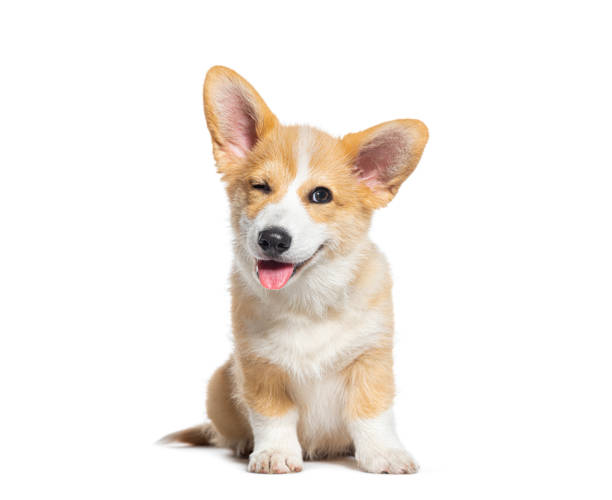
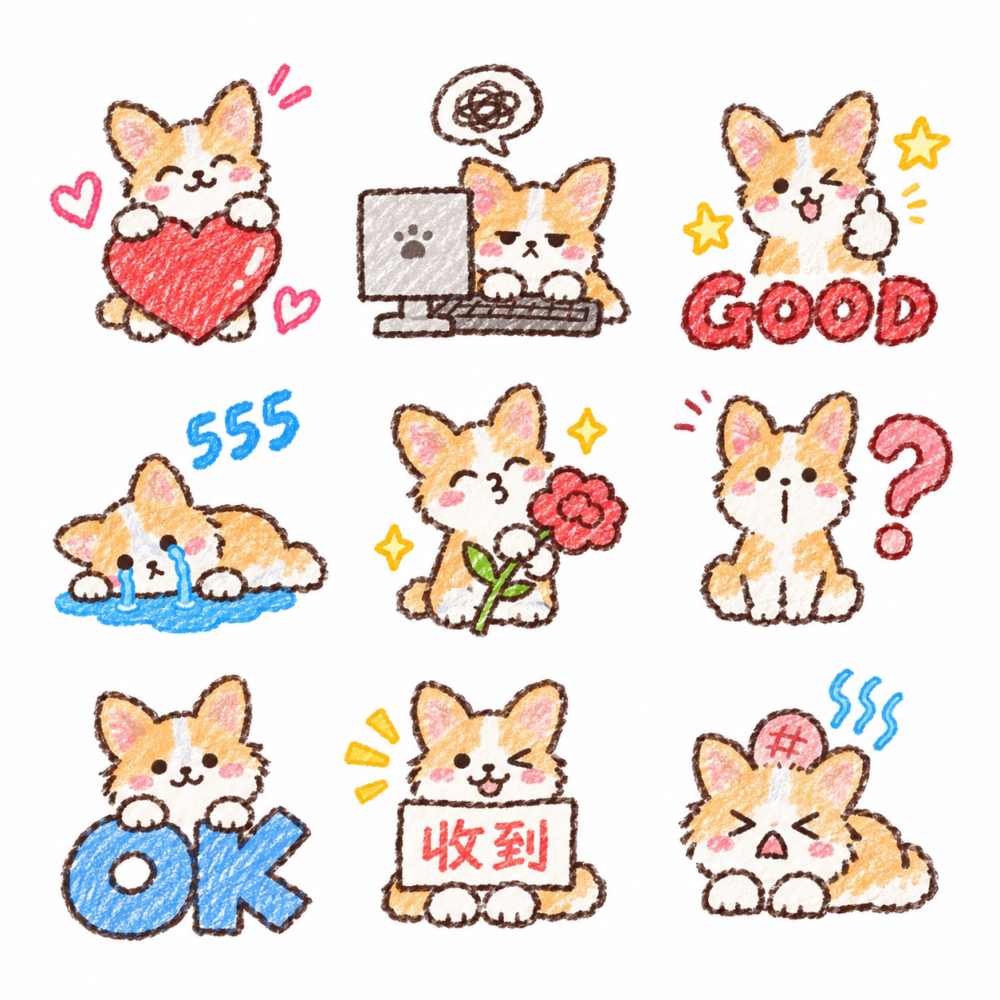

# Pet Sticker Studio

<div align="center">

<h1>Pet Sticker Studio</h1>

<p><strong>真实宠物 → 有辨识度的定制表情包</strong></p>

<table>
  <tr>
    <td align="center"><b>真实宠物照片</b><br /></td>
    <td align="center"><strong>→</strong></td>
    <td align="center"><b>生成的表情包</b><br /></td>
  </tr>
</table>

从宠物照片提取稳定的身份特征，再匹配不同画风，生成动作丰富、风格统一的九宫格表情包。

<p>
  
  
  
</p>

</div>

## 项目亮点

普通的“照片转卡通”很容易把宠物变成一只泛化的猫或狗。Pet Sticker Studio 采用 **identity-first** 方法，把“像不像这只宠物”和“画风像不像参考图”分开处理：

- **先提取身份特征**：固定物种、毛色分布、斑纹、脸型、耳朵、体型和固定配饰。
- **再匹配画风**：线稿、笔触、配色和构图分别由对应的 style skill 控制。
- **动作不被锁死**：站立、坐下、趴卧、侧躺、行走、奔跑、跳跃、探头等姿势可以自由变化。
- **九格保持一致**：同一只宠物、同一套画风、不同的表情和动作。
- **生成后做检查**：关注毛色漂移、脸型漂移、重复姿势和多余肢体等问题。

## 真实宠物 × 三种画风

<table>
  <tr>
    <th>真实宠物</th>
    <th>画风</th>
    <th>九宫格结果</th>
  </tr>
  <tr>
    <td rowspan="3"></td>
    <td align="center"><b>Hand-drawn</b><br />蜡笔 / 彩铅手绘</td>
    <td></td>
  </tr>
  <tr>
    <td align="center"><b>Flat cartoon</b><br />简洁扁平卡通</td>
    <td></td>
  </tr>
  <tr>
    <td align="center"><b>Doodle grid</b><br />轻量简笔涂鸦</td>
    <td></td>
  </tr>
</table>

## 从照片到表情包

```text
真实宠物照片
      ↓
身份特征卡：毛色 / 斑纹 / 脸型 / 耳朵 / 体型 / 配饰
      ↓
选择画风：Hand-drawn / Flat cartoon / Doodle grid
      ↓
动作与情绪设计：九种不同姿势，不固定原照片姿态
      ↓
九宫格表情包 + 单张贴纸素材
```

## 推荐使用方式

1. 将同一只宠物的正面、侧面或全身照片放入 `pets/<pet-name>/`。
2. 先使用 `pet-identity-sticker` 整理身份特征卡。
3. 选择一个画风 skill，提供对应的参考图。
4. 先生成一张试样，确认宠物辨识度和画风方向。
5. 再生成 3×3 九宫格，并检查九格的动作差异、比例和解剖结构。

## Skills

| Skill | 用途 |
| --- | --- |
| `pet-identity-sticker` | 提取身份特征，保持同一只宠物在不同动作和画风中的辨识度 |
| `pet-sticker-handdrawn` | 生成蜡笔 / 彩铅颗粒感的手绘贴纸 |
| `pet-sticker-flat-cartoon` | 生成粗描边、平色块、低阴影的扁平卡通贴纸 |
| `pet-sticker-doodle-grid` | 生成轻线稿、大留白、动作清晰的简笔九宫格 |

## 目录结构

```text
pet-sticker-studio/
├── skills/                 # 身份与画风 skills，包含必要参考图
├── pets/                   # 宠物照片、身份特征卡、确认记录
├── generated/              # 九宫格和单张生成结果
└── docs/
    └── assets/promo/       # README 宣传展示图
```

## 设计原则

> 固定宠物身份，放开动作和表情。

画风可以变化，动作可以变化，情绪可以变化，但宠物最重要的辨识点不能被风格化抹掉。九宫格不是把同一个姿势复制九次，而是让同一只宠物拥有一组有变化、有记忆点的表达方式。
