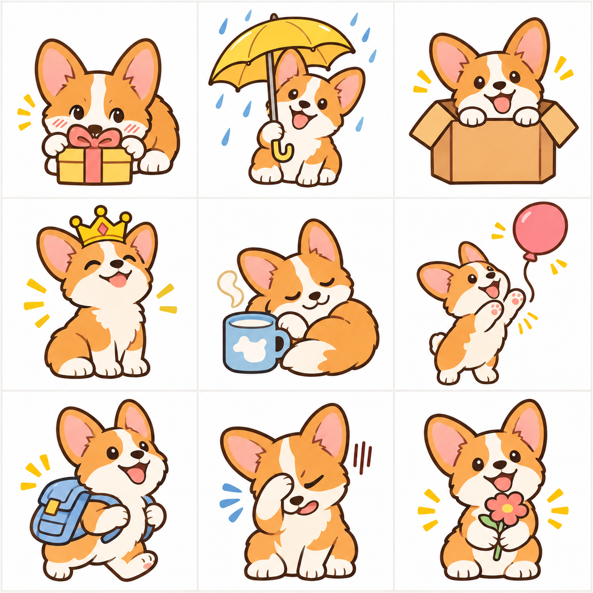
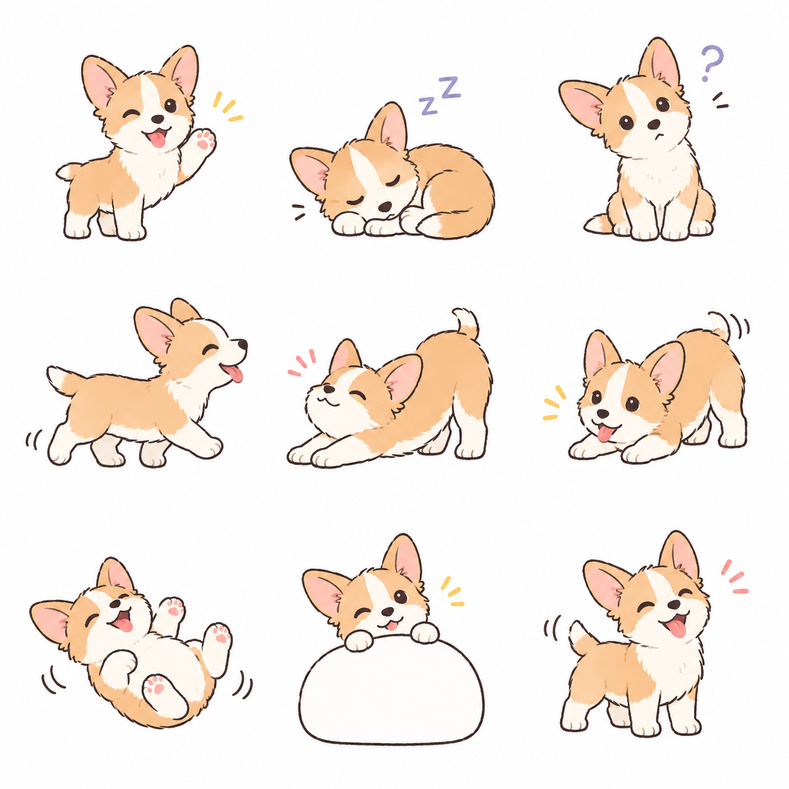
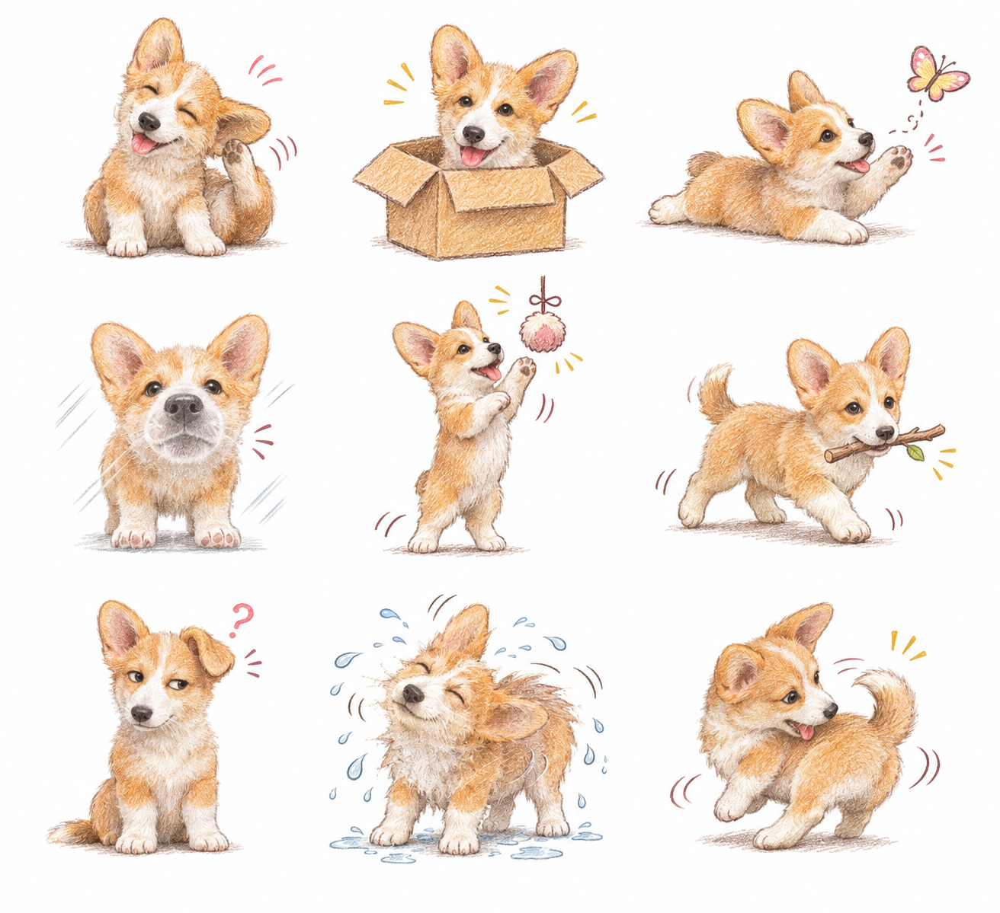
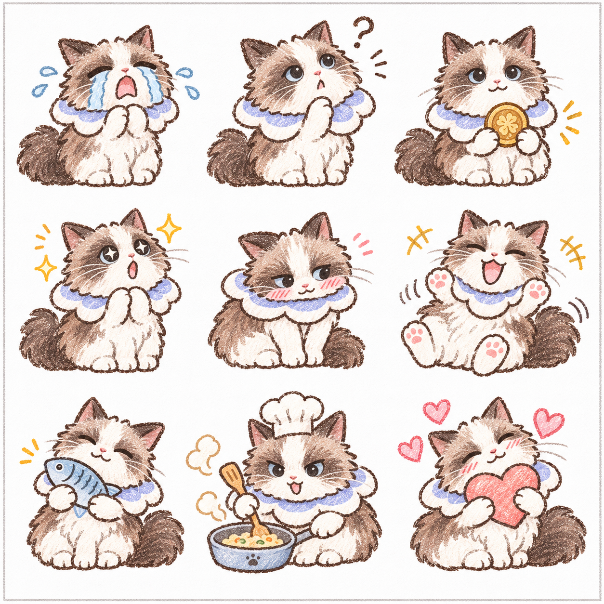
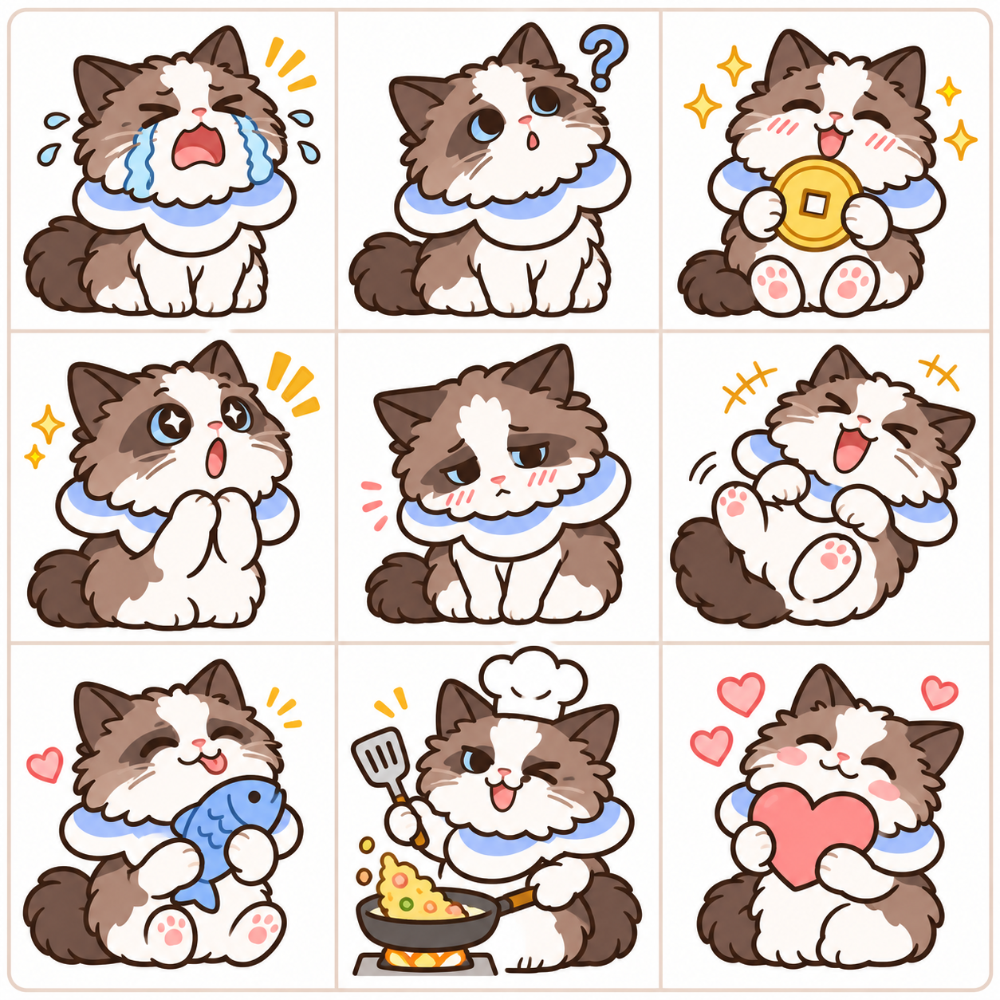
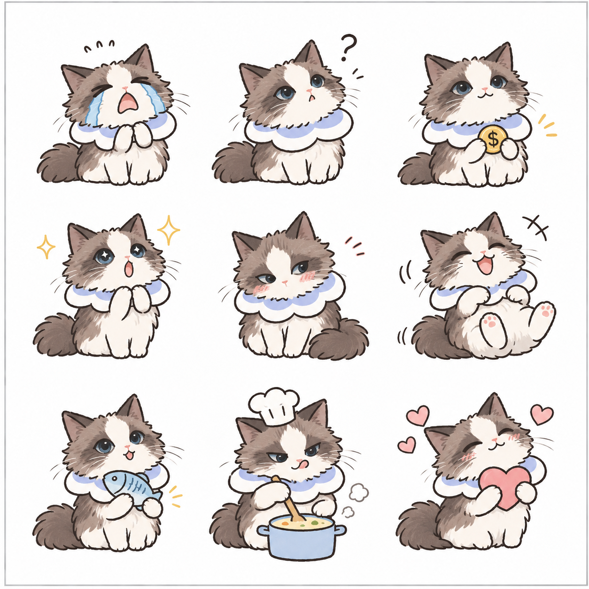
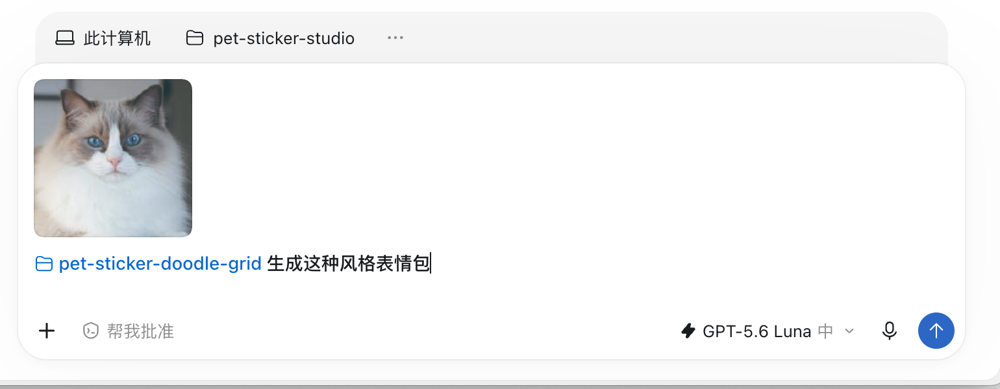
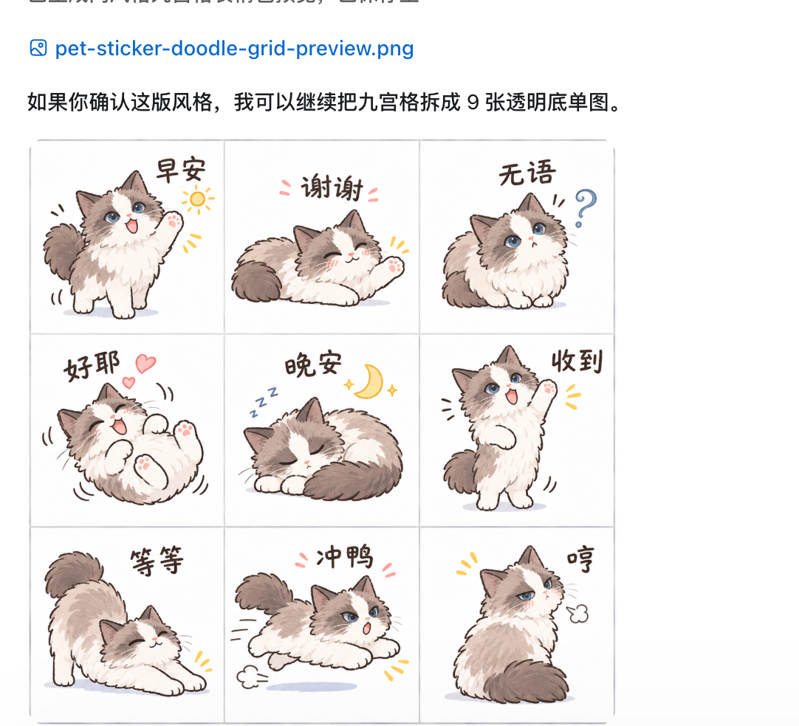

# Pet Sticker Studio

<div align="center">

<h1>Pet Sticker Studio</h1>

<p><strong>真实宠物 → 有辨识度的定制表情包</strong></p>

<table>
  <tr>
    <td align="center"><b>真实宠物照片</b><br /></td>
    <td align="center"><strong>→</strong></td>
    <td align="center"><b>生成的表情包</b><br /></td>
  </tr>
</table>

从一张宠物照片出发，先生成九宫格预览；确认方向后，再生成 9 张可直接使用的单张表情包。

<p>
  
  
  
</p>

</div>

## 项目亮点

## 一句话开始

上传一张宠物照片，然后说：

> 用手绘风生成一套九宫格表情包；我确认后，再把九宫格里的 9 个表情分别生成透明底单张表情包。

把“手绘风”替换成“扁平卡通风”“简笔涂鸦风”或“彩铅写实手绘风”即可。AI 会自动提取宠物身份、设计 9 个动作，并在你确认九宫格预览后逐张生成最终表情包。

普通的“照片转卡通”很容易把宠物变成一只泛化的猫或狗。Pet Sticker Studio 采用 **identity-first** 方法，把“像不像这只宠物”和“画风像不像参考图”分开处理：

- **先提取身份特征**：固定物种、毛色分布、斑纹、脸型、耳朵、体型和固定配饰。
- **再匹配画风**：线稿、笔触、配色和构图分别由对应的 style skill 控制。
- **动作不被锁死**：站立、坐下、趴卧、侧躺、行走、奔跑、跳跃、探头等姿势可以自由变化。
- **预览与交付分离**：九宫格只用于确认整体方向，最终交付 9 张独立表情包。
- **生成后做检查**：关注毛色漂移、脸型漂移、重复姿势和多余肢体等问题。

## 安装

使用 Skills CLI 安装：

```bash
npx skills add evander0x/pet-sticker-studio
```

## 真实宠物 × 四种画风

<table>
  <tr>
    <th>真实宠物</th>
    <th>画风</th>
    <th>宣传用九宫格预览</th>
  </tr>
  <tr>
    <td rowspan="3"></td>
    <td align="center"><b>Hand-drawn</b><br />蜡笔 / 彩铅手绘</td>
    <td></td>
  </tr>
  <tr>
    <td align="center"><b>Flat cartoon</b><br />简洁扁平卡通</td>
    <td></td>
  </tr>
  <tr>
    <td align="center"><b>Doodle grid</b><br />轻量简笔涂鸦</td>
    <td></td>
  </tr>
  <tr>
    <td align="center"><b>Colored pencil</b><br />彩铅写实手绘</td>
    <td></td>
  </tr>
</table>

## 其他动物表情包

下面的画风参考图展示了同一套生成能力也适用于其他动物；这里仅用于展示画风与表情包效果，不对应上方的真实宠物对照。

<table>
  <tr>
    <td align="center"><b>Hand-drawn</b><br />蜡笔 / 彩铅手绘<br /></td>
    <td align="center"><b>Flat cartoon</b><br />简洁扁平卡通<br /></td>
    <td align="center"><b>Doodle grid</b><br />轻量简笔涂鸦<br /></td>
  </tr>
</table>

## 从照片到单张表情包

```text
真实宠物照片
      ↓
AI 自动提取身份特征：毛色 / 斑纹 / 脸型 / 耳朵 / 体型 / 配饰
      ↓
选择画风：Hand-drawn / Flat cartoon / Doodle / Colored pencil
      ↓
阶段一：生成 3×3 九宫格预览，确认宠物辨识度、画风和动作
      ↓
阶段二：确认后，将 9 个格子分别生成 9 张透明底单张表情包
```

## 普通使用方式

1. 上传一张能看清宠物外形的照片。
2. 用一句话说明画风，并要求先出九宫格预览。
3. 预览满意后回复“按这个生成 9 张单图”。

## 教程截图

下面是一次从上传宠物照片到确认九宫格预览的示例：

<p align="center">
  
</p>

<p align="center">
  
</p>

## Skills

| Skill | 用途 |
| --- | --- |
| `pet-identity-sticker` | 提取身份特征，保持同一只宠物在不同动作和画风中的辨识度 |
| `pet-sticker-handdrawn` | 生成蜡笔 / 彩铅颗粒感的手绘贴纸 |
| `pet-sticker-flat-cartoon` | 生成粗描边、平色块、低阴影的扁平卡通贴纸 |
| `pet-sticker-doodle-grid` | 生成轻线稿、大留白、动作清晰的简笔九宫格 |
| `pet-sticker-colored-pencil` | 生成细密彩铅毛发、柔和纸感的写实手绘贴纸 |

## 目录结构

```text
pet-sticker-studio/
├── skills/                 # 身份与画风 skills，包含必要参考图
└── docs/
    └── assets/
        ├── promo/          # README 宣传展示图
        └── tutorial/       # README 教程截图
```

## 设计原则

> 固定宠物身份，放开动作和表情。

画风可以变化，动作可以变化，情绪可以变化，但宠物最重要的辨识点不能被风格化抹掉。九宫格只负责让用户快速确认一组动作和画风，最终使用的表情包应当是 9 张独立、完整、可直接发送的单图。
